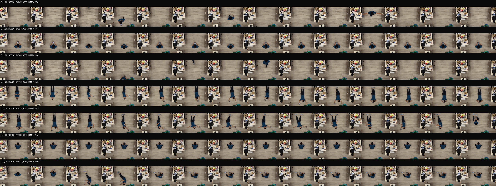

# Drone Fall and Action Detection

An experimental aerial safety-monitoring pipeline that detects people with YOLO11 pose, classifies short pose sequences, tracks multiple people, and raises an alert when a fall is followed by a person remaining down.

The project was designed for eventual deployment on a RobotX drone using an NVIDIA Jetson Orin Nano. It combines a public indoor fall dataset with custom top-down DJI recordings to reduce the viewpoint gap between ground-level training data and aerial use.



## Detection cases

- `falling_down`: active fall transition.
- `lying_down`: person remains horizontal after a fall.
- `sitting_kneeling`: seated or kneeling posture.
- `standing_still`: upright with limited motion.
- `walking`: normal walking motion.
- `running`: included in the combined label set, but absent from the held-out evaluation group and therefore not yet validated.

Each visible person receives an independent track ID, pose history, action state, and fall/lying timer. The preview prioritizes fall-related tracks:

- Red: fall followed by remaining down beyond the configured alert time.
- Orange: possible fall or recently fallen person requiring observation.
- Normal overlay: tracked person without an active fall state.

## Pipeline

```text
Camera or video
  -> YOLO11 pose estimation
  -> 17 normalized body keypoints per frame
  -> fixed-length temporal pose sequence
  -> statistical position, confidence, and motion features
  -> Random Forest action classifier
  -> multi-person tracking and fall-to-lying alert logic
```

## Evaluation snapshot

The included Orin evaluation report contains 406 pose sequences with a subject-grouped split: 268 training samples and 138 test samples.

| Measure | Result |
| --- | ---: |
| Overall accuracy | 84.1% |
| Weighted F1 | 84.7% |
| Falling-down F1 | 85.2% |
| Lying-down F1 | 89.6% |
| Walking F1 | 87.5% |

These are baseline development results, not evidence of production safety performance. The test group had no `running` samples, the public source data is primarily indoor footage, and the custom aerial set is small. Real deployment requires more independent drone-height, lighting, crowd, terrain, and camera-motion validation.

See the complete JSON reports in [`reports/`](reports/).

## Repository contents

```text
Fall-Action-Project/
├── src/                    # Preparation, pose extraction, training, and inference
├── models/                 # Current lightweight Random Forest classifier
├── reports/                # Evaluation reports
├── evidence/               # Contact sheet from custom top-down recordings
├── run_orin_live.sh        # Jetson Orin live-camera launcher
└── requirements.txt
```

Raw videos, public dataset files, generated pose arrays, TensorRT engines, ONNX exports, and virtual environments are intentionally excluded from Git.

## Installation

```bash
python -m venv .venv
source .venv/bin/activate       # Linux / Jetson
pip install -r requirements.txt
```

On Windows PowerShell, activate with:

```powershell
.\.venv\Scripts\Activate.ps1
```

Ultralytics can download `yolo11n-pose.pt` automatically on first use. Jetson deployment can instead pass a locally built TensorRT engine with `--pose-model`.

## Run a video demo

```bash
python src/run_video_demo.py \
  --video path/to/test_video.mp4 \
  --classifier models/current_pose_rf.pkl \
  --pose-model yolo11n-pose.pt \
  --lying-alert-sec 3
```

## Run live detection

```bash
python src/run_live_camera.py \
  --camera 0 \
  --classifier models/current_pose_rf.pkl \
  --pose-model yolo11n-pose.pt \
  --max-people 8 \
  --lying-alert-sec 10
```

Add `--headless` when no preview window is required. Increase `--lying-alert-sec` to reduce short false alarms.

## Rebuild and train

Prepare the GMDCSA24 segment manifest:

```bash
python src/prepare_gmdcsa24.py \
  --dataset path/to/GMDCSA24 \
  --output outputs/gmdcsa24_segments.csv
```

Extract temporal pose sequences:

```bash
python src/extract_pose_sequences.py \
  --manifest outputs/gmdcsa24_segments.csv \
  --output outputs/pose_sequences.npz \
  --sample-fps 5 --seq-len 32 --device 0
```

Train the classifier:

```bash
python src/train_pose_classifier.py \
  --pose-npz outputs/pose_sequences.npz \
  --manifest outputs/gmdcsa24_segments.csv \
  --model-out models/new_pose_rf.pkl \
  --report-out reports/new_pose_rf_report.json
```

## Jetson Orin

The original deployment used a platform-specific TensorRT pose engine and the included Random Forest classifier. Build the engine on the target Jetson, then run:

```bash
PYTHONNOUSERSITE=1 python src/run_live_camera.py \
  --camera 0 \
  --pose-model yolo11n-pose.engine \
  --classifier models/current_pose_rf.pkl \
  --max-people 8 \
  --lying-alert-sec 10
```

## Safety and privacy

This is a research prototype and must not be treated as an emergency-response or medical device. Do not rely on it as the only fall-detection or rescue mechanism. Obtain consent, minimize retained footage, protect recordings, and follow applicable privacy and aviation rules.

Python pickle files can execute code when loaded. Only use the included classifier or another model from a source you trust.

## Hiker fall/action workspace

The original 5060 hiker fall/action-detection workspace is preserved separately in [`hiker-fall-detection/`](hiker-fall-detection/). It includes its runnable Python pipeline, training scripts, compact models, reports, figures, processed pose data, and prediction evidence without overwriting this curated drone project.
