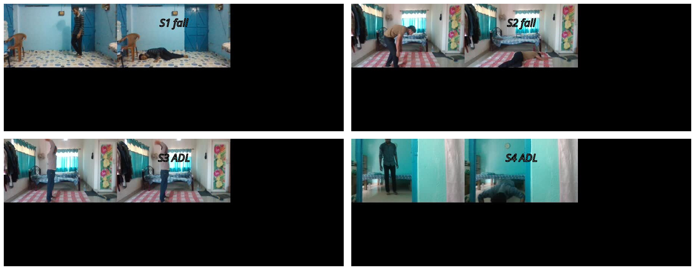
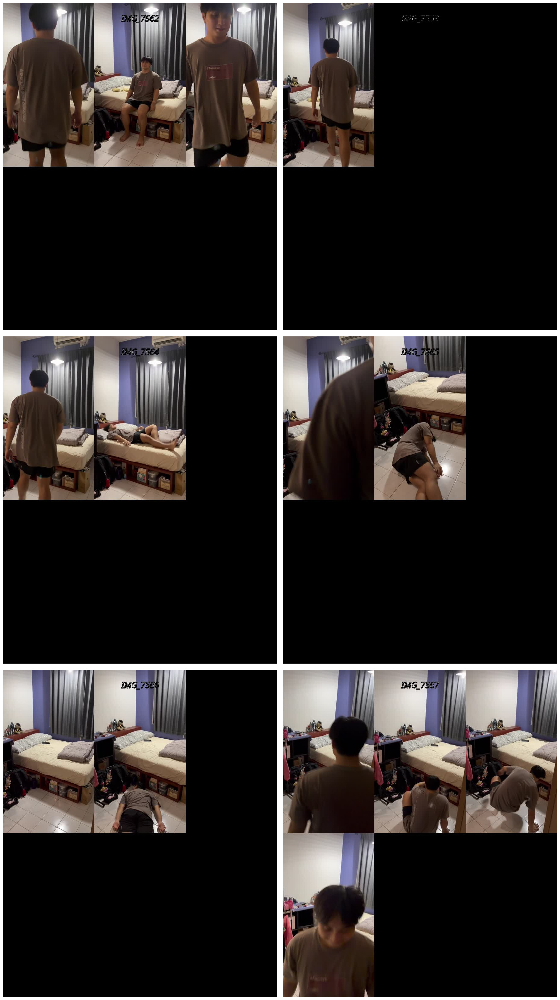
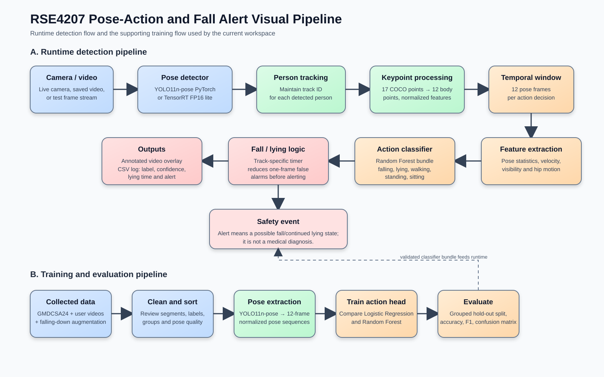

# RSE4207 five-class pose-action training report

Date: 2026-10-14  
Workspace: `/home/robotx/rse4207_ws`

## Outcome

The workspace now contains a trained five-class action model at
`models/actions.pkl`, a reproducible dataset manifest and extraction pipeline,
and a live/video runner at `run_trained.sh`.

Classes are:

```text
falling_down, lying_down, walking, standing, sitting
```

The selected model is a Random Forest over temporally normalized YOLO11 pose
features. On the grouped hold-out split it reached 73.5% accuracy and 0.732
macro F1. A Logistic Regression baseline reached 69.6% accuracy and 0.700
macro F1. These are action-classification results, not a claim of medical fall
diagnosis.

## Visual data review

The following contact sheets show representative frames used to understand the
domain difference between the public indoor footage and the user's recordings.
They are visual samples, not additional training labels.

### GMDCSA24 examples



GMDCSA24 provides different rooms, clothing, backgrounds, and fall/ADL
appearances. The selected examples include fall clips and ordinary ADL clips,
which are important for reducing false positives.

### User recording examples



The user recordings are portrait-oriented, close-range, and mostly show one
person in a bedroom. They include sitting, standing, walking, falling, and
lying transitions. This is useful for adapting the action head, but it is not
enough by itself to represent outdoor, aerial, or multi-person scenes.

## Dataset strategy and size

The training set combines:

| Source | Videos/groups | Segments/sequences | Notes |
|---|---:|---:|---|
| GMDCSA24 | 83 source-video groups from four subjects | 336 | Existing labeled fall and ADL segments; external diversity source |
| User recordings | 6 clips | 21 | The six files found in this workspace, temporally segmented |
| Total | 89 groups | 357 | Five-class normalized label set |

Final sequence counts are: falling 79, lying 83, walking 60, standing 57,
and sitting 78. Each sequence contains 12 pose frames sampled from its
segment. User pose extraction had an average detection rate of 82.9%; this
should be checked before treating the result as production-ready.

The user clips are not all single actions. They include transitions such as
standing-to-sitting and standing-to-floor. Therefore the manifest labels short
time ranges rather than assigning one label to an entire clip. The annotation
file is `data/user_segments.csv` and is intentionally easy to edit.

## Method

## Visual pipeline

The complete runtime and training flow is shown below. The runtime path uses
YOLO pose keypoints, temporal action features, the five-class action head, and
the track-specific lying/fall timer. The training path shows how reviewed
videos become normalized pose sequences and how the classifier is evaluated.



1. YOLO11n-pose extracts 17 COCO body keypoints from each sampled frame.
2. Coordinates are normalized relative to the hip center and torso scale.
3. Temporal features include relative pose mean/std, final pose, velocity,
   confidence/visibility, horizontal body orientation, and hip motion.
4. A 12-frame window is passed to two candidate action heads: Logistic
   Regression and Random Forest.
5. The split is grouped by source video and subject/file group, so nearby
   overlapping windows cannot leak across train and test.
6. The Random Forest is refit on all training sequences and saved in the exact
   bundle format expected by `run_detection.py`.

The pose detector itself is not modified or retrained here. The modification
is at the action head and temporal feature stage, which is less expensive and
keeps the existing multi-person tracker compatible. The previous iterations
still represent inference configurations: stock single-person, lightweight
single-person, four-person, and eight-person/full-skeleton modes.

## Distinguishing falling from lying/sitting

`falling_down` is learned from short motion segments with rapid posture change;
`lying_down` is the post-transition horizontal/down state; `sitting` is the
upright bent-hip state. Runtime decisions are stabilized by probability
smoothing over the tracked person's sequence. The existing safety timer only
raises the `falling_down` display alert after continuous `lying_down` for the
configured duration. This is a temporal engineering rule, not a medical
diagnosis and not proof that a fall occurred.

The principal remaining ambiguity is a person intentionally lowering to the
floor, sitting on the floor, or lying on a bed. More side-view and oblique
view examples, especially negative sitting/resting examples, are needed.

## GMDCSA24 use and limitations

GMDCSA24 supplies labeled fall and activities-of-daily-living examples from
four subjects, with changes in rooms, lighting, clothing, and complex ADLs.
It is used here for pose-sequence pretraining and as the main external source
of negative/positive variation. It is not aerial data, so it cannot by itself
validate drone-camera performance. The public dataset reports 81 falls and 79
ADL clips; the local prepared manifest expands their labeled time ranges into
336 training sequences.

## Reproduction

```bash
cd /home/robotx/rse4207_ws
python3 prepare_user_manifest.py
/home/robotx/fall_action_project/.venv/bin/python extract_user_sequences.py --device cpu
/home/robotx/fall_action_project/.venv/bin/python train_rse_actions.py
./run_trained.sh --source IMG_7565.MOV --headless \
  --output reports/IMG_7565_trained.mp4 \
  --stats reports/IMG_7565_trained.json
```

The detailed machine-readable evaluation is in `reports/training_report.json`.

## Orin Nano deployment

The trained action head is small and CPU-friendly. On the Orin Nano, the
recommended runtime is the YOLO11n-pose detector in TensorRT FP16 plus the
saved Random Forest action head. The action head does not require retraining
on the Orin Nano.

### Copy the package

Copy this workspace to the Orin Nano, or at minimum copy:

```text
run_detection.py
action_core.py
run_trained.sh
models/actions.pkl
/home/robotx/fall_action_project/yolo11n-pose.pt
```

Install the Jetson-compatible versions of Python, PyTorch, Ultralytics,
OpenCV, NumPy, SciPy, and scikit-learn. Use the NVIDIA JetPack-provided
PyTorch/TensorRT builds where possible; do not copy x86 Python wheels to the
Jetson.

### Recommended settings

```bash
./run_trained.sh --source 0 --imgsz 384 --max-people 1 \
  --lying-seconds 10 --headless
```

For a higher-accuracy single-person mode use `--imgsz 640`. For multiple
people, increase `--max-people` carefully because pose inference is the main
compute cost. Keep the action sampling rate at 8 Hz and use the existing
tracking/timer logic to avoid flickering labels.

### TensorRT export on the Orin Nano

Run this on the Orin Nano after installing the Jetson-compatible Ultralytics
and TensorRT stack:

```bash
yolo pose export model=yolo11n-pose.pt format=engine \
  imgsz=384 half=True device=0
```

Then pass the resulting `.engine` file through `--pose-model`. Validate the
engine on a short recorded clip before using a live camera. If FP16 export is
not available, use the PyTorch `.pt` model at a smaller image size.

The Random Forest model is stored as `models/actions.pkl`; it runs after pose
inference and uses no GPU. The continuous-down timer is deliberately kept
outside the classifier so the Orin Nano can make a conservative alert only
after a person remains in the down state for the configured duration.

### Orin Nano acceptance checks

Before field use, measure processing FPS, end-to-end latency, GPU memory,
temperature, and missed detections on all five action types. Test both front
and side views, people at different distances, empty scenes, sitting on the
floor, lying on a bed, and controlled safe falls. The model is a research
prototype and is not a medical or emergency-response system.

## Response to proposal feedback

- Dataset size is now quantified by source groups, sequences, class counts, and
  detection rate; the user data is kept separate in the manifest.
- Data diversity comes from four GMDCSA24 subjects plus the user's six-room
  setup recordings, but aerial diversity is still missing.
- GMDCSA24 is explicitly used as the external, labeled fall/ADL source rather
  than being mentioned only as future work.
- Falling versus sitting/resting is defined through pose geometry plus motion
  and a continuous post-down timer; the limitations are stated explicitly.
- Two action-head baselines are evaluated, with Random Forest selected because
  it performed better on the grouped hold-out split.

## Recommended next data collection

For a defensible final evaluation, collect at least 5--10 people, 3 camera
angles (side, oblique, overhead), multiple distances and lighting conditions,
and repeated examples of sitting, resting, kneeling, lying on a bed, and
controlled falls. Keep entire people and recording sessions out of the test
set. Do not use dangerous uncontrolled falls; use a safe mat and supervision.

## Source

GMDCSA24 paper and dataset details: https://doi.org/10.1016/j.dib.2024.110892  
Dataset repository: https://github.com/ekramalam/GMDCSA24-A-Dataset-for-Human-Fall-Detection-in-Videos
