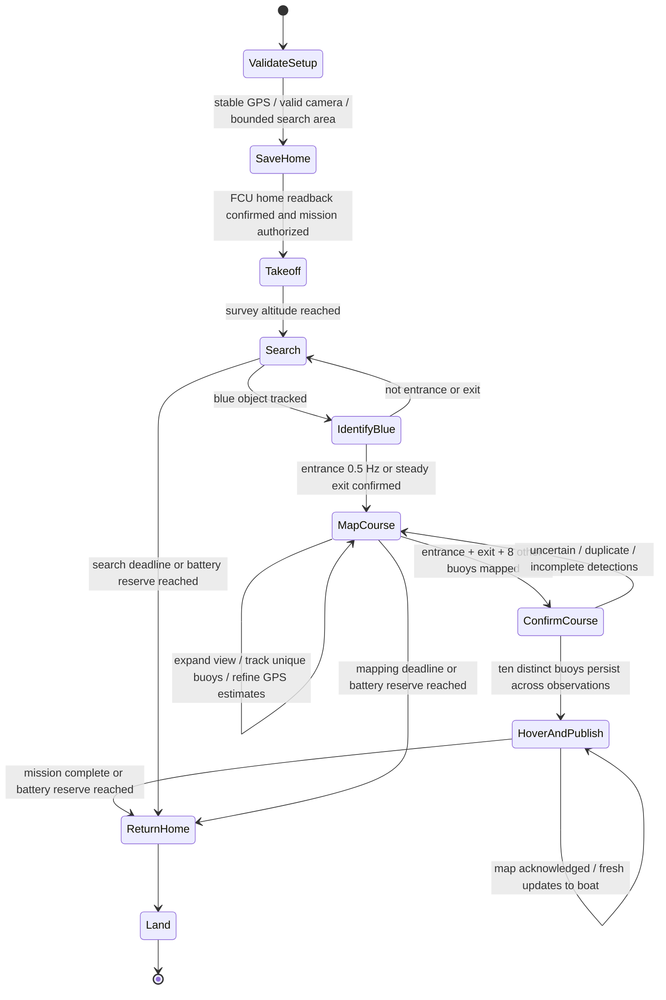

# Proposed hardware workflow — not yet a flight implementation

Hardware assumption: a fixed downward-facing Raspberry Pi Camera Module 3.
Standard vs wide variant, resolution/crop, lens focus, mounting rotation, lever arm,
and camera calibration must be established on the actual aircraft. The existing
GitHub detector is still a placeholder. Gazebo scene changes do not implement
the hardware mission, camera driver, or boat navigation controller.

## Mission states

The docked launch location should be saved as the FCU home/RTL destination and
read back for confirmation before flight. A normal GPS RTL is not precision docking;
repeatable touchdown on a small pad needs a landing target and suitable precision
landing support. RTL altitude and route must account for the site's obstacles.
Operator takeover and FCU failsafes take priority throughout the mission.

## Search and identification

Searching for any blue object is an acquisition cue, not proof of a course. Dock
lights, water, reflections, and boat paint can also be blue. Classify buoy shape,
spatial context, and temporal brightness together, then associate detections over
time. Do not identify an exit from a single bright frame: a blinking entrance can
be in its on phase. Observe multiple complete cycles (for example 6–10 seconds
at a stable viewpoint) and reject ambiguous tracks.

Before the first mission, provide a search polygon or a center/radius entirely
inside permitted open water, a survey altitude, a maximum altitude, and a timeout.
An unrestricted random search cannot provide a bounded completion time or route.
Fly overlapping survey passes within that boundary. Once a blue buoy is confirmed,
hover over open water, increase altitude within the limit to expand the view, and
move toward the estimated course center. A downward camera cannot search beyond
its current ground footprint. If all ten do not fit in one usable image, accumulate
a map across overlapping views rather than continuing to climb.

The current simulated layout has 2 blue, 3 green, 3 red, and 2 black buoys. Docks,
each buoy's separate bulb, and repeated observations do not increase the count.
Detecting ten is not proof no additional buoys exist: finish coverage of the course
boundary and check association/confidence. Black hazards remain black, so detection
must also use shape and contrast rather than relying exclusively on emitted light.

## Camera pixels to latitude/longitude

Use the calibrated intrinsic matrix K and lens distortion coefficients for the
actual image mode and focus setting. Associate every exposure with synchronized
FCU position, roll, pitch, yaw, and camera height above the water surface. Relative
altitude above home is not automatically height above water. Compensate camera
offset from the drone's navigation reference and mounting rotation.

For each undistorted buoy feature `(u,v)`, form a camera ray
`r_camera = inverse(K) * [u,v,1]` and rotate it into a common local world frame:
`r_world = R_world_body * R_body_camera * r_camera`.
Given camera position C and a water/feature plane at z = z_target:

`lambda = (z_target - C.z) / r_world.z`

`P = C + lambda * r_world`

Reject near-horizontal rays, intersections behind the camera, stale telemetry,
and solutions outside the search area. The selected pixel's feature height matters:
a bulb above water must not be projected as if it lies on the water surface. Use a
known feature height, the waterline, or multi-view estimation.

This is ray/plane intersection, not triangulation. True triangulation combines
rays to the same feature from multiple known camera positions. It needs sufficient
baseline, synchronized poses, correct track association, and treatment of moving
buoys; averaging repeated frames from one stationary position does not resolve depth.
Neither approach guarantees exact coordinates. Convert the local solution through
a WGS84-referenced local frame/ECEF transform and report horizontal uncertainty.
RTK positioning on both vehicles may be needed for tight navigation accuracy;
GPS decimal precision alone is not accuracy.

## Boat-side software

The boat starts in WAIT_FOR_COURSE. A dedicated receiver validates a versioned map
with a mission ID, increasing sequence, capture timestamp, coordinate datum,
complete flag, and exactly ten unique buoy IDs. Each buoy carries class/color,
role (entrance/exit/gate/hazard), latitude, longitude, uncertainty, and last-seen
time. Include a checksum/authentication scheme appropriate to the network, reject
stale/replayed or out-of-area maps, and acknowledge a valid complete map. UDP
delivery alone is not confirmation that the boat has received usable coordinates.

After validation the boat plans a route through gate centers with clearance from
buoy positions, hazards, banks, and docks. It must not navigate directly into buoy
coordinates. Route planning needs the gate-order rule, hull dimensions, stopping
distance, current/wind allowance, and a maximum accepted mapping uncertainty.
The boat proceeds only after its own navigation and arming prerequisites pass.
Loss of fresh map data must lead to a defined hold/abort behavior, not continued
navigation on an indefinitely stale map. Autonomous docking is a separate final
behavior from course traversal.

## Inputs still required before hardware implementation

- Camera variant, image mode, calibration, and fixed focus/mount settings.
- Search polygon/center-radius, survey/max/RTL altitudes, and mission timeout.
- Drone and boat positioning accuracy, time synchronization, and map tolerance.
- FCU firmware/vehicle endpoints and the boat's navigation/gate-order behavior.

References:
- Camera capture/focus: https://datasheets.raspberrypi.com/camera/picamera2-manual.pdf
- Calibration/projection: https://docs.opencv.org/4.x/d9/d0c/group__calib3d.html
